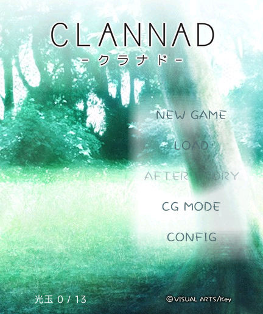
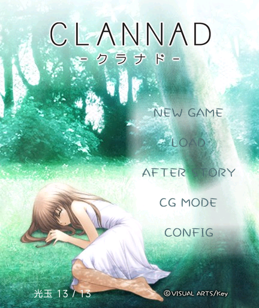

# CLANNAD · REDMI Watch 5

当前正式版 **0.2.0** 调整安装包压缩方式、延后标题音乐启动，光玉计数右移，并按原作真结局进度切换标题背景。安装包 **24,989,857 字节（约 24.99 MB）**，小于 25,000,000 字节。52 项自动检查、官方模拟器安装和两轮完整音乐重播通过。**维护者于 2026-10-25 确认 0.2.0 已通过 REDMI Watch 5 实机测试**。

| 真结局通关前 | 真结局通关后 | 阅读菜单 |
| --- | --- | --- |
|  |  |  |

截图来自官方 Vela 原生模拟器。通关后截图载入由真实攻略回放引擎生成的测试进度，仅用于检查显示与持久化；不表示本轮在原生模拟器里完整通关。原作：[Key CLANNAD](https://key.visualarts.gr.jp/product/clannad/index.html) / [Steam](https://store.steampowered.com/app/324160/)。下载：[GitHub 0.2.0 正式版](https://github.com/xuanyide01/clannad-rw5/releases/tag/v0.2.0)；旧版安装包保留在 Releases。

## 0.2.0 安装与标题优化

- 用户反馈 0.1.5 第一次安装使手表重启，第二次安装成功，原因尚未确认。参考同一工作区《命运石之门0》的封装方案，使用生产构建、减少 ZIP 解压量并保持 r1 尾部对齐；这些改动旨在减轻安装和启动负担，0.2.0 已获得维护者实机测试通过的反馈；未单独测量固件安装器峰值内存。
- PNG、PCM 音乐和字体改为 ZIP STORE。需解压的文件从 1546 个减至 744 个，最大单文件从 2,397,732 字节减至 262,226 字节。部分 JPEG 和文本仍压缩以满足 25 MB 上限；相对 0.1.5，原有全部 `common/` 资源逐字节不变，图片、音乐和字体没有再次降低质量。实际固件安装器峰值内存尚未测量。
- 标题就绪后延迟 1.8 秒再启动音乐；离开页面、切到后台或退出时取消待启动任务，失效回调不会重新开启播放。完整《汐》与保护重播规则保持不变。
- 光玉计数从左侧 20 像素移到 56 像素，避开屏幕左下圆角。
- 真结局前使用原作 `STT_BG00` 无汐背景，原脚本 `seen6803` 写入 `g[45] = 1` 后切换到含汐的 `STT_BG10`。仅有 13 枚光玉或开放 After Story 不会提前切换；路线/章节浏览不会写入通关进度。原有通关记录会继续生效。
- 两图从相同 1280 × 960 原图画布裁剪相同区域 `[0,0,807,960]` 并缩放为 432 × 514；上部森林和右侧树干像素一致，切换不会因裁剪产生位移，含汐图仍与 0.1.5 逐字节相同。
- 52 项自动检查包含实际攻略产生真结局标记、正常阅读与跳章的选项保护、旧存档、音乐计时和失效回调。原生模拟器完成安装、旧档读取、自动播放、选项暂停、CG 差分、路线首屏返回、两轮完整音乐重播与通关前后标题检查。见 `reports/final-validation-v020.json` 和 `native-test-results/v020/`。

由 **Codex** 完成开发与整理。自编代码 MIT；原作图像、文本、音乐和第三方内容按各自许可处理。

SHA256：`3460cdbbf751bafd92ee945ffcd2b5367c3932bf47e6eb8998c469f2763757e0`。

## 0.1.5 绿色按钮、无损压缩与《汐》

- 阅读菜单、CONFIG、确认和返回等控件统一浅绿色；保留标题原作手写按钮。快速切页后，旧 CG 和章节按钮事件会被拒绝，避免误跳页面和音乐串页。
- 397 张 PNG 经 zopfli 无损重编码，比原文件合计减少 1,975,975 字节。所有保留图片的 RGBA、分辨率、PNG 类型和颜色信息逐一核对；JPG、剧情、字体、光玉、CG 分组、自动播放规则和存档模块保留。还删除了两个已不被界面引用的旧图片。
- 标题使用原作完整的《汐》，原脚本 `@MPLAY(＠タイトル)` 和音乐表指向 `BGM30.nwa`；音乐鉴赏目录首项原图也标为“汐”。Gameexe 中为从头至文件结束、从头重复。来源记录见 `reports/title-music-v015-source.json`。
- 原音源约 72.93 秒，转为 16 kHz 单声道 16-bit PCM，末尾附加两秒静音保护。音频做了重采样和声道压缩；图片不因此降低画质。
- 约每 72.93 秒主动停止，等待 1.2 秒再从头播放，关闭系统自动循环并避开自然 EOF；离开标题/设置/说明页、切到后台或退出时停止并清理计时器。CONFIG 可开关音乐，设置会保存；不改动系统音量。
- 官方模拟器完整经过两次保护停止和重播；旧存档、自动播放、选项保护、CG 差分与路线导航通过。原生立绘区和 CG 图片像素与 0.1.4 截图相同。检查见 `reports/final-validation-v015.json` 和 `native-test-results/v015/`。
- 本地实时预览中，点击“启用预览声音”后可听到与原生播放进度同步的《汐》。该开关只控制电脑预览；手表使用 CONFIG 设置。

自编代码与适配由 **Codex** 完成。原游戏音乐和图像不属于 MIT 许可范围。

SHA256：`0da0f72c8fd2bd9871caa11286ec0ada20911b5b95c5596b0205354c3e64f9b9`。

## 0.1.4 界面与自动播放

- 标题采用原作含汐的森林背景，使用原始 G00 中的 NEW GAME、LOAD、AFTER STORY、CG MODE、CONFIG 按钮；保留原作字样与比例，并适配手表点击区域。
- CONFIG 中提供显示速度、字号、路线/章节和操作说明。After Story 继续按原脚本条件解锁。路线/章节直达属于浏览模式，不计入光玉和通关记录。
- 存读档、CG、路线与菜单使用森林浅绿底和原作蓝色渐变按钮；对白区保留深色底，移除姓名框与正文框装饰，立绘下沿仍贴齐对白区。
- 阅读菜单开启“自动播放”，点击“返回游戏”继续。自动模式按约 30 毫秒一字显示，整句完成后等待：慢速 2.6 秒、标准 1.5 秒、快速 0.8 秒；超过 60 字的段落按额外字数延长等待，额外时间最多 5 秒。开启时已显示完整的当前句直接开始等待，后续句子逐字显示；手动显示速度的设置保持独立。
- 遇到选项必须由玩家选择，之后自动继续。打开菜单、存读档或滑动正文时暂停，返回正文/结束滑动后重新计时；切到后台不推进。手动点击未完成的文字先补全整句，再重新等待。
- 点击“上一句”、返回标题、剧情结束或报错会关闭自动播放。每次启动默认关闭，只保存速度档位；读写 30 个旧存档的格式和键不变。
- 原有剧情、背景、立绘、CG、字体、圆形图标及存档模块与 0.1.3 逐字节相同；原作按钮来源及摘要见 `reports/original-ui.json`。

0.1.4 历史检查报告：`reports/final-validation-v014.json`，原生过程截图与检查：`native-test-results/v014/`。完整剧情遍历和攻略报告沿用已验证且未改动的原引擎；本轮未宣称实机完整通关所有路线。

SHA256：`ed5e8483498e6898913a7604daea00b370b56dce81fab6019ed4b4c582699e2a`。

使用用户提供的 Steam 官方中文版资源制作，版本 0.2.0。安装包小于 25,000,000 字节。由 Codex 完成资源格式分析、转换、阅读程序编写与虚拟机检查；用户提供原游戏和设备测试条件。

两个版本的 `SceneZH.pck`、`GameexeZH.dat`、`SiglusEngine_Steam.exe` 的 SHA-256 相同，2367 个 G00 文件的名称与大小一致。网传版另有不同的 Steam 接口文件，因此使用 Steam 文件夹作为资源来源。没有运行网传版的可执行程序，也没有改动原游戏目录。

## 已实现

- 中文剧情、背景、完整透明角色立绘；保留 309 组选项、原脚本变量、条件分支和跨章节调用，包括风子路线的动态恶作剧选项。
- 立绘按原图比例缩放并贴齐文本框上缘；定时切换表情替换原立绘，避免同一人物重复出现。标题根据原版真结局通关记录切换同视角背景。
- 跨周目保存原版 `g[]` 全局变量，保留光玉收集、After Story 解锁及真结局条件。读旧存档和上一句操作不会回退已保存的全局进度。
- 30 个独立存档栏位，显示章节、时间与对白预览，保存到已用栏位前确认覆盖。
- 标题界面选择路线与章节；菜单中跳至下一章；上一句、即时/逐字显示、标准/大字号。
- 按原版 CG 目录整理 68 组、174 张 CG；相同场景的差分合并，打开后点击图片切换。
- 针对系统缺少的 23 个字形加入 Noto 字体子集，包含“柊”“祐”等字。只对需要补字的完整文本使用补充字体。

## 测试范围与限制

0.1.3 已由维护者确认通过 REDMI Watch 5 上机测试。0.1.5 的首次安装曾使设备重启、第二次安装成功；0.2.0 的优化已通过模拟器检查，维护者于 2026-10-25 确认实机测试通过。小米手环 8 Pro 尚未适配。此次反馈不表示所有路线已在实机完整通关；攻略路径的自动检查范围见下文。

0.1.4 共 39 项自动检查通过，包含实际页面、自动播放定时器、选项暂停、后台与存读档保护。原有完整剧情检查覆盖 195 个章节入口的两种选择策略，共 390 次遍历；每次到达结束或回到重复的玩家选择状态，没有出现无输入死循环。还检查了脚本分块、图像引用、30 槽状态保存、界面串行读取、全局进度存储失败重试和字体覆盖。

以 [Kazamatsuri 原版攻略](https://kazamatsuri.org/clannad-walkthrough/) 的主要路线选择为参考，在实际转换引擎中从序章逐一走完美佐枝、智代、有纪宁、琴美、杏、胜平、春原兄妹、风子、幸村与渚的结局，随后完成 After Story 首周目、秋生路线和真结局；额外检查椋与风子的另一结局。每次选择后保存/恢复状态，跨周目进度由剧情产生，未直接注入通关标记。检查结果见 `reports/guide-validation.json`。这验证了这些攻略路径，不表示所有版本、所有支线攻略都已穷尽测试。

全部 309 组选项还逐一核对了原始指令：中文数据库编号、选项顺序、目标变量与返回值一致。检查结果见 `reports/choice-source-audit.json`。

官方 `vela-watch-5.0` 虚拟机中检查了旧版 30 槽保存/读取、更新包后冷启动读取、下一章、CG 差分、标准/大字号和代表路线的立绘。检查记录位于 `native-test-results/`，每份报告包含对应安装包哈希；0.1.2 的检查独立保存于 `native-test-results/v012-final/`；0.1.3 的安装包检查见 `reports/final-validation-v013.json`。

为了满足体积上限，背景与 CG 缩放为手表尺寸 JPEG，角色立绘保留完整轮廓与 8 位透明度，颜色降至每通道 5 位。同姿势、同服装的表情差分合并为代表立绘，**并未保留每一种原版表情**。

本版提供标题曲《汐》，不含其他背景音乐、语音、视频或原版动画。风子恶作剧保留文字选项和剧情判定，省略原版图片按钮与动画；桌面输入和计时演出简化为静态图文。原版演出体验没有完整复刻。

按照攻略游玩请从标题选择“开始游戏”，通关后再开始新周目；满足原版条件后标题会开放 After Story。手动选择路线/章节属于浏览功能，不计入全局通关记录。菜单“下一章”按原剧情快进到首个选项或下一章开头，不绕过选择；从“开始游戏”游玩时继续保留通关记录和光玉判定。原中文版脚本以 13 枚光玉判断真结局；部分其他版本攻略写作 14 枚，本程序遵循用户提供的原脚本，不额外增加光玉。


## 0.1.2 修正与攻略校对

- 修正 11 组配角 CG 的人物标注；美佐枝、早苗、秋生、芳野、胜平、直幸等不再统一标为幸村，原差分分组保持不变。
- 修复路线第一页进入琴美章节及返回时文字不刷新的问题；章节目录中将误标的“棒球篇”改为实际的“春原结局”。
- 安全跳章执行原脚本变量、条件和场景调用，在选项处停下，必须自行选择；每批快进让出界面，暂停后可继续。
- 按[和结的 12 篇攻略合集](https://www.bilibili.com/opus/429633532904766006)校对。16 条路线/结局回放包含渚、幸村、琴美、有纪宁、杏、胜平、风子、美佐枝、智代、春原兄妹、春原结局、棒球、喷气齐藤与 After Story 三个周目。正常阅读与安全跳章的最终状态一致，选择后保存/恢复也一致。攻略前言计入 12 篇，部分文章同时包含多个结局；空白栏是任选项，条件选项可能因前置选择或周目而不出现。报告见 `reports/bilibili-guide-review.json` 和 `reports/bilibili-skip-validation.json`。

## 安装与恢复

将 `clannad-rw5-v0.2.0.bin` 导入“表盘自定义工具”，按其应用安装流程传输。BIN 与 RPK 是同一安装包的两种扩展名，选择一种即可。工具提示传输完成后，**还需等待手表端完成安装**，不要马上反复重装。

安装时保留足够空间供安装包与展开资源同时存在；不要同时安装多个接近 25 MB 的大型游戏来挤满空间。安装包展开约 32.94 MB，虚拟机安装过程中还需要临时文件空间。

如果应用无法继续：先返回标题选择其他章节；能保存时先存入另一个栏位。应用无响应时通过侧键返回手表系统，再打开应用读取存档。整机无响应时按设备官方说明强制重启。不要刷写系统或使用来历不明的恢复包。卸载可能清除存档，优先反馈章节、栏位、操作步骤和设备系统版本。

模拟器检查不构成实机稳定性保证；本安装包为普通 Vela 应用，不包含系统固件或刷机功能。

## 本地构建

项目中已转换的 `src/common/` 资源可直接构建。需要 Node.js 与 aiot-toolkit 1.1.0：

```powershell
npm install --prefix tools/compat-toolkit --ignore-scripts
node tools/build.cjs --low-memory
$env:CLANNAD_FULL_VALIDATION='1'
node --test tests/*.test.cjs
```

0.2.0 发布包使用生产构建，勿添加 `--development`。`tools/install-deflate-cache/` 随源码提供文本的无损 DEFLATE 缓存，构建时按 SHA256 匹配并逐字节校验。修改转换后的剧情文本后，如需重新生成缓存以满足体积限制：

```powershell
python -m pip install zopfli
python tools/prepare-install-deflate.py
```

标题背景重提取脚本依赖未随源码提供的原作解码中间图；构建安装包可直接使用已有两张 JPEG，无需重新提取。

使用 fontTools 重建字体或验证字体覆盖：

```powershell
python tools/build-text-font.py path/to/NotoSansMonoCJKsc-Regular.otf
python tools/check-text-font.py
```

仓库包含构建所需的已转换 `src/common/` 资源和供自动检查使用的 `converted-story/` 数据，可直接构建和运行检查。`tools/convert-*.py` 等为资源研究脚本，依赖未随仓库发布的 `clannad-probe/` 中间数据及 SiglusSceneScriptUtility；原游戏重新提取流程尚未整理成一键转换工具。

## 致谢与许可

- 参考移植作者 [liuyuze61](https://github.com/liuyuze61) 的 [ATRI 1.5.1](https://api.bandbbs.cn/wftools/bandbbs.html?code=A&state=1820673) 与 [星空列车与白的旅行 v1.0.0](https://api.bandbbs.cn/wftools/bandbbs.html?code=A&state=1841662)，以及 [ATRI-miband](https://github.com/liuyuze61/ATRI-miband)。
- 感谢 [表盘自定义工具及 bandbbs 相关团队](https://www.bandbbs.cn/) 提供安装工具。
- Siglus 数据分析与 G00 解码使用 [SiglusSceneScriptUtility](https://github.com/Jirehlov/SiglusSceneScriptUtility)。
- 字体使用 [Noto CJK](https://github.com/notofonts/noto-cjk)，保留 SIL OFL 1.1 许可，修改字体名为 CLANNADExtraSubset。

自编代码采用 MIT 许可。原游戏文本、CG、背景、立绘、图标及截图涉及原作资源，**不属于 MIT 授权范围**。第三方许可见 `licenses/`。项目地址：[xuanyide01/clannad-rw5](https://github.com/xuanyide01/clannad-rw5)。

## 0.1.3 圆形封面图标

应用图标采用正版 Steam 缓存中与维护者所给截图相同的“渚撑伞”封面原图，裁剪上部人物和伞，输出 192 × 192 圆形 RGBA PNG，圆外透明。原图入口：[Steam CLANNAD](https://store.steampowered.com/app/324160/)。游戏标题仍使用含汐的原版通关背景。

除图标及版本信息外，游戏页面代码与全部剧情、立绘、CG、字体和存档格式与 0.1.2 逐字节相同。新包已通过签名、文件摘要和官方模拟器全新安装、启动检查，维护者于 2026-10-09 确认本版本已通过 REDMI Watch 5 上机测试：安装正常、圆形图标正常，暂未发现其他 bug。

本包 **24,613,132 字节**，小于 25 MB。SHA256：`c2125e3169ac42ab171772f7344244e6e63268eb1475cf5d766188df7e227283`。


## 联系方式

问题反馈与交流：[shining237841@gmail.com](mailto:shining237841@gmail.com)。
